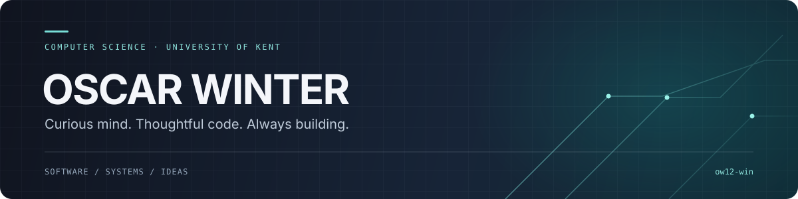
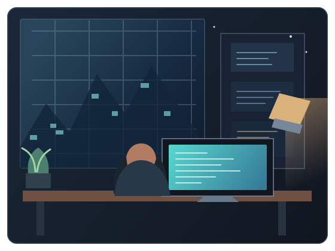

<div align="center">
  
</div>

<br />

<h2 align="center">☕ &nbsp; A little about me</h2>

<table>
  <tr>
    <td width="58%" valign="middle">

```js
const oscar = {
  name: "Oscar Winter",
  studying: "Computer Science @ University of Kent",
  interests: [
    "building things from first principles",
    "computer vision & machine learning",
    "systems, algorithms & creative coding",
  ],
  beyondCode: "Maths + CS subject prefect",
  motto: "stay curious; keep making",
};
```

  </td>
  <td width="42%" valign="middle" align="center">
    
  </td>
 </tr>
</table>

<div align="center">

*Computer Science student • University of Kent • United Kingdom*

I’ve been curious about computers for as long as I can remember. I like learning by making, exploring how software and systems work, and finding new ideas to follow.

**Currently open to 2027 industrial placement opportunities**

</div>

<br />

<h2 align="center">✦ &nbsp; Connect with me</h2>

<div align="center">
  <a href="https://github.com/ow12-win"></a>
</div>

<br />

<h2 align="center">⌘ &nbsp; Tech stack</h2>

<div align="center">
  <sub>LANGUAGES</sub><br />
  
  
  
  
  
  
  
  
  <br /><br />
  <sub>TOOLS &amp; EXPLORATION</sub><br />
  
  
  
  
  
  
  
  
</div>

<br />

<h2 align="center">⌁ &nbsp; GitHub analytics</h2>

<div align="center">
  
  
</div>

<br />

<div align="center">
  
</div>

<br />

<div align="center">
  <sub>Made with curiosity, coffee, and a lot of tabs.</sub>
</div>
