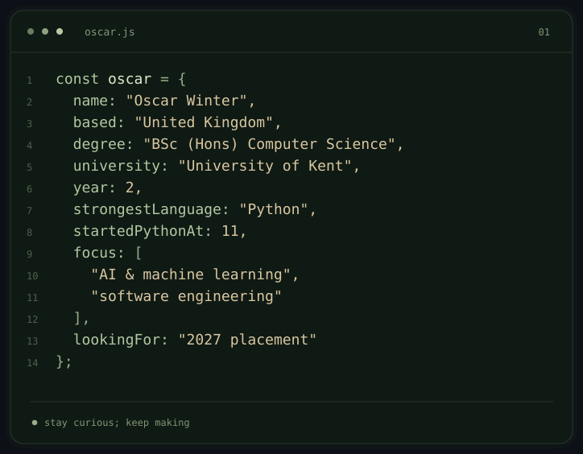
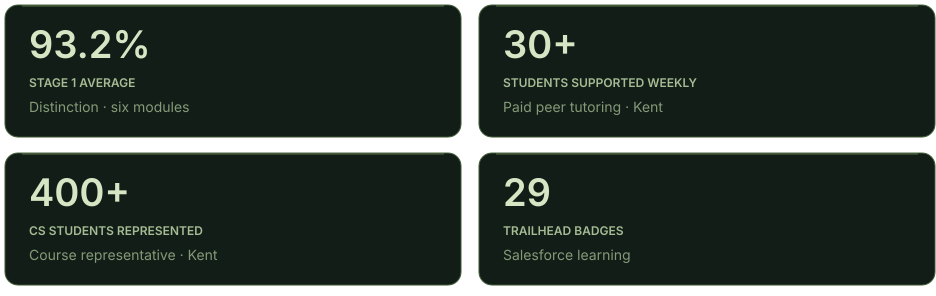
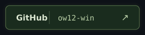
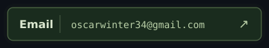
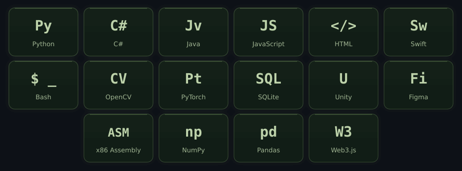

  

  SOFTWARE ENGINEERING &nbsp; / &nbsp; AI &amp; MACHINE LEARNING

<a href="mailto:oscarwinter34@gmail.com">oscarwinter34@gmail.com</a>

 

  
  <picture>
    <source media="(prefers-reduced-motion: reduce)" srcset="./assets/about-oscar.svg" />
    
  </picture>

 

  Second-year <strong>BSc (Hons) Computer Science</strong> student at the University of Kent. 
  Python since age 11. Interested in AI, machine learning, and software engineering. 
  <strong>Seeking a 2027 industrial placement.</strong>

  

 

  

<strong>Academic results and current study</strong>

**Stage 1 Distinction — 93.2% mean** across six equally weighted, 20-credit modules.

| Module | Mark |
| :--- | ---: |
| Foundations of Computing | 99% |
| Internet | 98% |
| Computer Systems | 97% |
| Programming I | 91% |
| Human–Computer Interaction | 89% |
| Programming II | 85% |

**A-level Computer Science project:** 67/70.

**Current Stage 2 study:** Algorithms and Databases; marks not yet available.

**Previous qualifications:** A-level Computer Science **A**, Mathematics **B**, Physics **B**; BTEC IT Level 2 **Distinction\***; 10 GCSEs, including **Grade 8 Computer Science**.

 

**Paid Peer Tutor / Teaching Assistant · University of Kent · Current**  
Support **30+ first-year students weekly** in COMP4100 (Programming I), independently helping them debug Python code and understand programming concepts. Adapt explanations to different learning needs.

**Computer Science Course Representative · University of Kent · Current**  
Represent **400+ Computer Science students**, gathering feedback in classes and through QR-code surveys on module structure and assignment clarity, and communicating student perspectives to university staff.

**Salesforce CRM Intern · CRM.Team, Bishop’s Stortford · Summer 2025**  
Completed **29 Salesforce Trailhead badges** covering CRM workflows and Salesforce tools. Shadowed business meetings and commercial discussions to understand how client-facing software teams operate.

**IT Work Experience · IT Vet · 2024 · One week**  
Completed patch-panel exercises and observed technical support calls. Wiped and remounted drives in customer loan computers and prepared networking equipment for ticketed installations. Received a **post-sixth-form role offer**.

**Lifeguard · Everyone Active · August 2024–February 2025**  
Independently supervised pools with **20+ users**. Completed NPLQ first-aid and rescue training, including coordinated five-person casualty-extraction drills.

**Beyond university**  
Former Mathematics and Computer Science subject prefect at **Birchwood High School**, supporting Year 9–11 pupils during classwork. Hold the **National Pool Lifeguard Qualification (NPLQ)**.

 

  <a href="https://github.com/ow12-win"><picture>
    <source media="(prefers-reduced-motion: reduce)" srcset="./assets/github-link.svg" />
    
  </picture></a>
  <a href="mailto:oscarwinter34@gmail.com"><picture>
    <source media="(prefers-reduced-motion: reduce)" srcset="./assets/email-link.svg" />
    
  </picture></a>

Open to 2027 industrial placement opportunities.

 

**Strongest language:** Python, used since age 11. Working with **PyTorch in my current project**, alongside experience with pandas, scikit-learn, computer vision, and model evaluation.

  <picture>
    <source media="(prefers-reduced-motion: reduce)" srcset="./assets/toolkit.svg" />
    
  </picture>

 

  

 

ROOTED IN CURIOSITY. ALWAYS GROWING.

